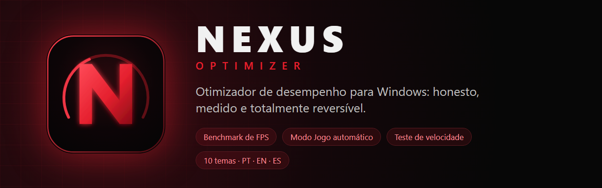

<div align="center">



<br>

[](https://github.com/carlosguilhe/Nexus-Optimizer/releases/latest)
[](#install)
[](https://tauri.app)
[](LICENSE)

[Português](README.md) · **English**

</div>

---

## What it is

**Nexus Optimizer** is a Windows performance optimizer for gamers. It applies real system tweaks, **measures the result** and **undoes everything** whenever you want.

Most optimizers promise "infinite FPS" and "zero lag" without proof. Nexus does the opposite:

- **It measures, it does not promise.** FPS benchmark powered by [PresentMon](https://github.com/GameTechDev/PresentMon), measurement history and a **guided A/B test** that only keeps a tweak when the gain exceeds the test's own noise.
- **Everything is reversible.** The original value is saved before touching the registry. Every tweak has a **Revert** button, plus **Revert all**, Windows restore points and an activity history.
- **Honest about what works.** Each tweak shows its risk (safe, moderate, advanced) and a frank note about the expected gain. The **Help** tab separates real, small and placebo effects.
- **No telemetry.** Nothing from your PC is sent. The internet is used only for the speed test, the game catalog and the update check.
- **No cheats, no overlay.** No skin changers and no in-game overlay, which anti-cheat systems may treat as tampering.

> Screenshots in this repository use **sample data** (fictional hardware) only to illustrate the interface. See the [Portuguese README](README.md) for the full gallery.

## Features

- **44 tweaks** in 9 categories, all with backup, risk level and revert. Global search (`Ctrl+K`). Includes turning off Copilot and Recall, the classic context menu, hidden files, hibernation and more.
- **Self-update from GitHub releases:** downloads the new installer, verifies its SHA-256 and updates in one click (or automatically, if you enable it).
- **Windows tools:** install popular programs through winget (closed list, with progress), **Windows Update control** (Default / Security only / Manual), one-click **Windows features** (.NET 3.5, DirectPlay, WSL, Sandbox, Hyper-V…) and shortcuts to classic panels (network, power, sound, Device Manager, Services…).
- **Game catalog (~10k games)** and **automatic Game Mode**: when a game opens, its **own profile** is applied (priority, temporary tweaks, programs to close, CPU cores) and **everything is undone** when it closes.
- **FPS benchmark** (average, 1% low, frametime) with charts, **history**, **guided A/B test** and HTML **reports**.
- **Speed test** with a gauge, live **CPU/RAM/NVIDIA GPU monitor**.
- **Network:** latency to cloud regions and game services, **live ping**, **route tracing**, **fastest-DNS finder**, DNS switcher.
- **Maintenance:** categorized cleanup (analyze before deleting, optional scheduled cleanup), free RAM, disk health, **SFC/DISM** with progress, **disk space analyzer**, drivers (links to the official sites), uninstaller, bloatware removal, startup and process managers.
- **10 themes** with previews · **Português, English, Español** · system tray · global hotkeys (`Ctrl+Alt+G`, `Ctrl+Alt+R`) · Windows notifications · first-run wizard · config export/import · update check.

## Install

1. Download `Nexus-Optimizer_1.0.0_x64-setup.exe` from **[Releases](https://github.com/carlosguilhe/Nexus-Optimizer/releases/latest)**.
2. Run it. The install is per-user and **does not need administrator**.
3. For the benchmark and system tweaks, open the app as administrator (use **Reopen as administrator** in the sidebar).

> **SmartScreen:** the installer is **not code-signed** (a signing certificate is paid). Windows may warn you: click *More info → Run anyway*. Verify the SHA-256 hash published on the release if you want to be sure.

**Requirements:** Windows 10/11 (64-bit) with WebView2.

## Build from source

Prerequisites: [Rust](https://rustup.rs) (stable), [Node.js](https://nodejs.org) 20+, Visual Studio Build Tools (*Desktop development with C++*) and WebView2.

```powershell
git clone https://github.com/carlosguilhe/Nexus-Optimizer.git
cd Nexus-Optimizer
npm install
powershell -ExecutionPolicy Bypass -File scripts/get-presentmon.ps1   # downloads PresentMon and checks its hash
npm run tauri dev       # development
npm run tauri build     # installer in src-tauri/target/release/bundle/nsis
```

Backend tests: `cd src-tauri && cargo test --lib`.

## Privacy and security

No telemetry, no account, no ads. Network is used for the speed test (Cloudflare, CacheFly), the game catalog (a public list of detectable apps), update checks (GitHub API) and game icons (public CDN). External commands receive only validated values or values from closed lists.

## Credits

[PresentMon](https://github.com/GameTechDev/PresentMon) (Intel, MIT) · [Lucide](https://lucide.dev) (ISC) · the public detectable-games list from Discord for game names and icons · Cloudflare and CacheFly for the speed test. All trademarks belong to their owners; this project is not affiliated with them.

## Disclaimer

This software changes Windows settings. Each change is reversible from the app, but **use it at your own risk** and create a restore point before advanced tweaks. Licensed under [MIT](LICENSE).
