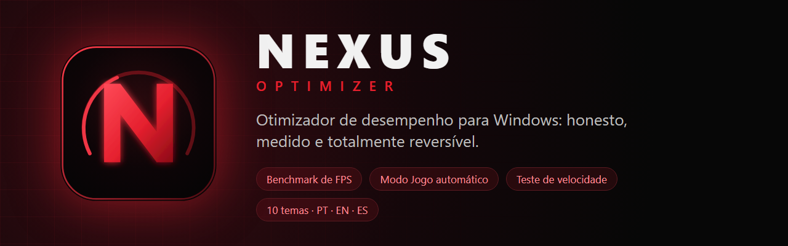
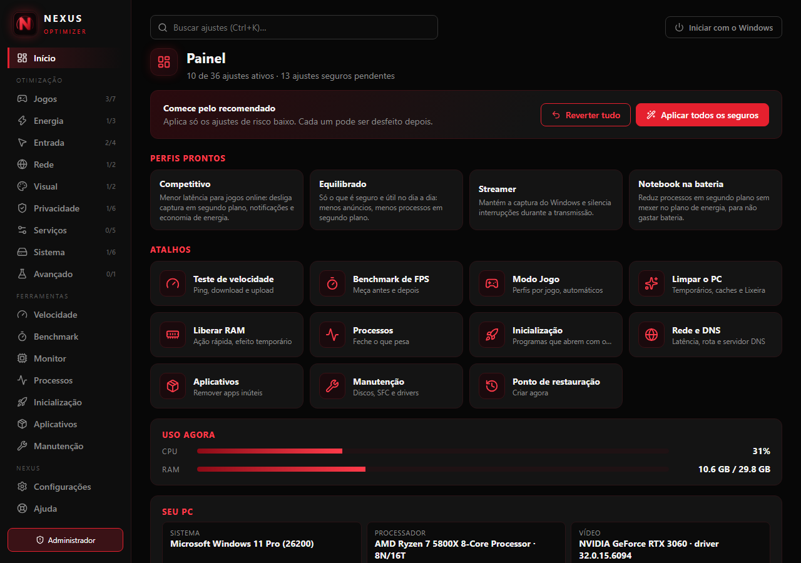
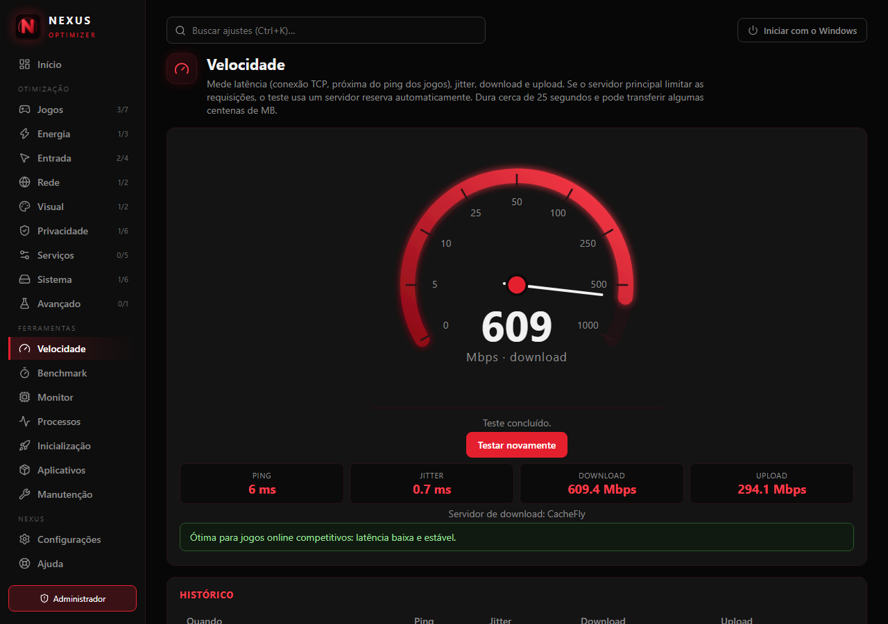
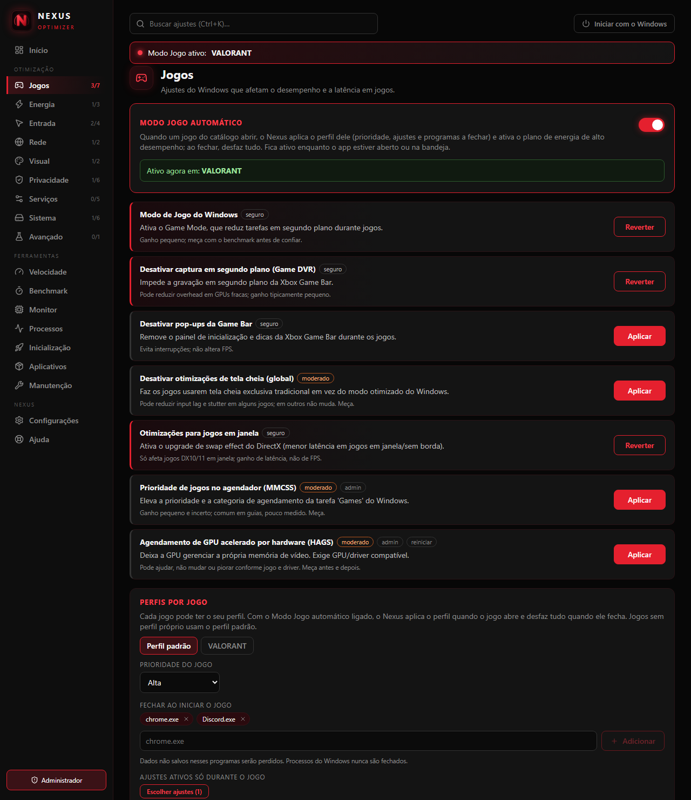
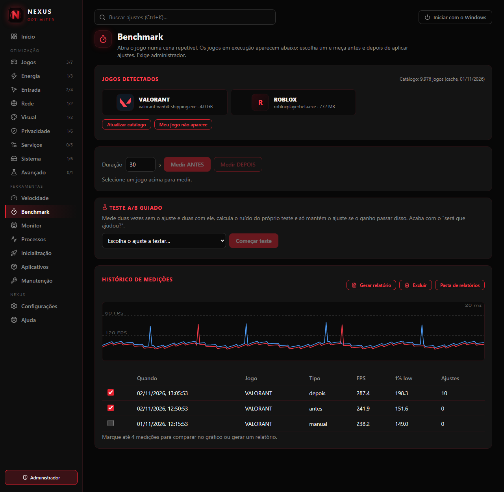
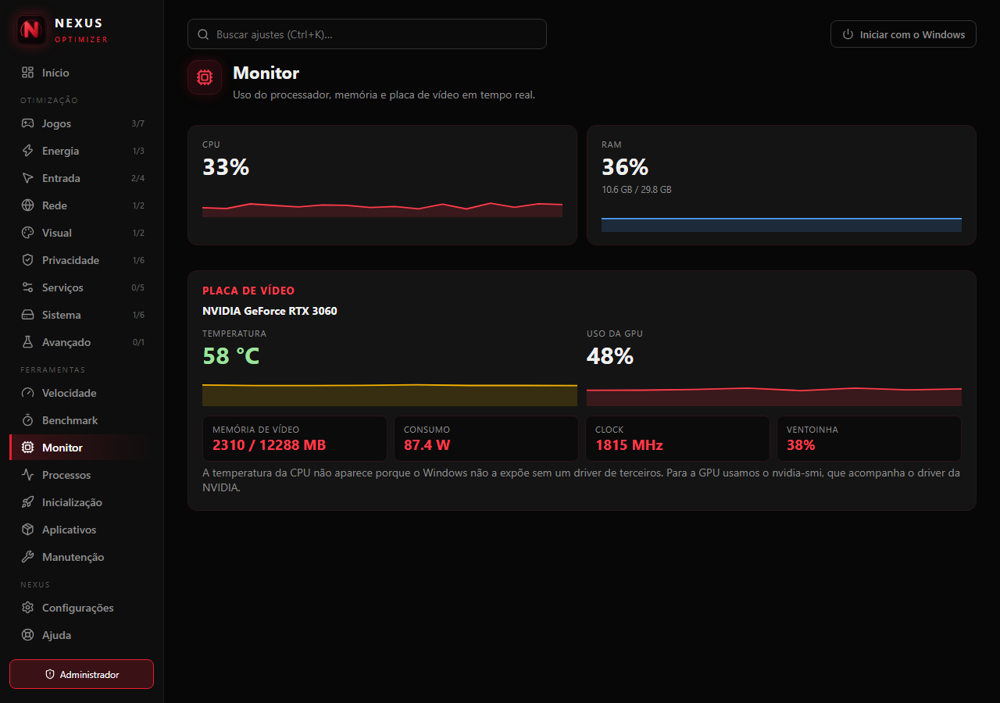
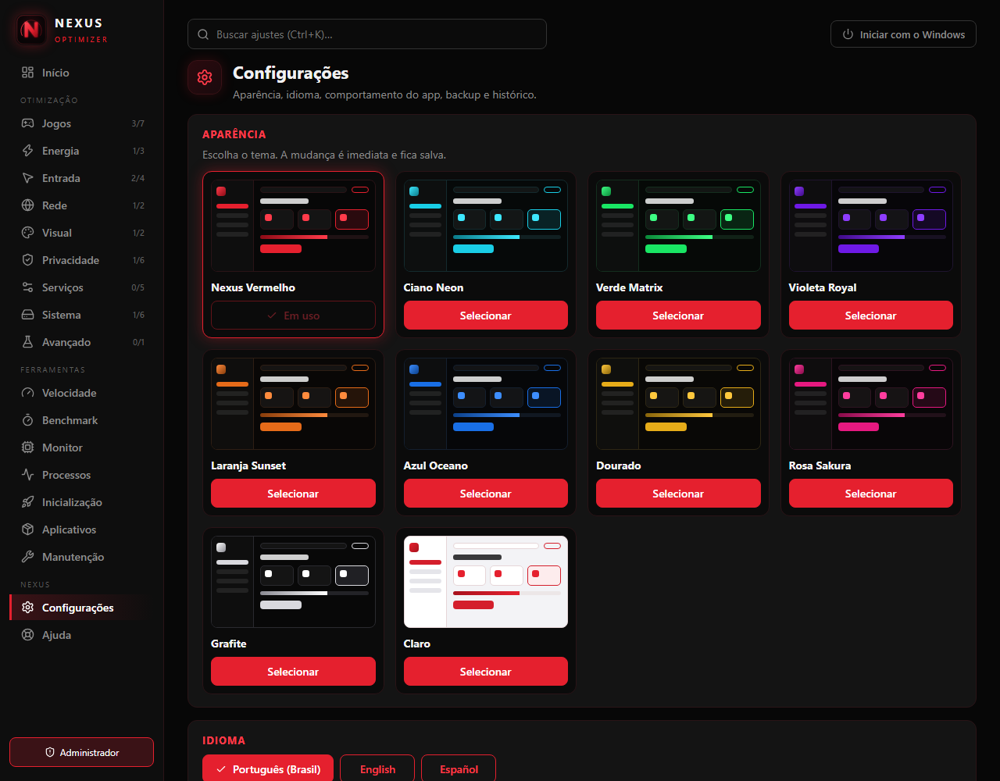

<div align="center">



<br>

[](https://github.com/carlosguilhe/Nexus-Optimizer/releases/latest)
[](#instalação)
[](https://tauri.app)
[](https://www.rust-lang.org)
[](LICENSE)

**Português** · [English](README.en.md)

</div>

---

## O que é

O **Nexus Optimizer** é um otimizador de desempenho para Windows feito para quem joga. Ele aplica ajustes reais do sistema, **mede o resultado** e **desfaz tudo** quando você quiser.

A maioria dos otimizadores promete "FPS infinito" e "zero lag" sem provar nada. O Nexus faz o contrário:

- **Mede, não promete.** Benchmark de FPS com [PresentMon](https://github.com/GameTechDev/PresentMon), histórico de medições e um **teste A/B guiado** que só mantém um ajuste se o ganho passar do ruído da própria medição.
- **Tudo é reversível.** Antes de mexer no registro, o valor original é guardado. Cada ajuste tem o botão **Reverter**, e há **Reverter tudo**, ponto de restauração do Windows e histórico de atividades.
- **Honesto sobre o que funciona.** Cada ajuste mostra o risco (seguro, moderado, avançado) e uma nota sincera sobre o ganho esperado. A aba **Ajuda** separa o que é real, pequeno e placebo.
- **Sem telemetria.** Nada do seu PC é enviado. A internet é usada só para o teste de velocidade, o catálogo de jogos e a verificação de atualizações.
- **Sem cheats e sem overlay.** Nada de skin changer nem de overlay dentro do jogo, que podem ser vistos como adulteração por sistemas anticheat.

> As capturas de tela abaixo usam **dados de exemplo** (hardware fictício) apenas para ilustrar a interface.

## Capturas de tela

<table>
  <tr>
    <td width="50%"><br><sub><b>Início</b>: perfis prontos, atalhos, uso em tempo real e diagnóstico do PC.</sub></td>
    <td width="50%"><br><sub><b>Velocidade</b>: velocímetro com ping, jitter, download e upload.</sub></td>
  </tr>
  <tr>
    <td width="50%"><br><sub><b>Jogos</b>: Modo Jogo automático e perfil individual para cada jogo.</sub></td>
    <td width="50%"><br><sub><b>Benchmark</b>: jogos detectados com ícone, teste A/B e histórico com gráfico.</sub></td>
  </tr>
  <tr>
    <td width="50%"><br><sub><b>Monitor</b>: CPU, RAM e GPU NVIDIA em tempo real.</sub></td>
    <td width="50%"><br><sub><b>10 temas</b>, cada um com miniatura, e 3 idiomas.</sub></td>
  </tr>
</table>

## Funcionalidades

### Ajustes (36, em 9 categorias)
Jogos · Energia · Entrada · Rede · Visual · Privacidade · Serviços · Sistema · Avançado. Todos com backup do valor original, nível de risco, aviso de **reiniciar** quando preciso e busca global (`Ctrl+K`). Inclui plano de energia próprio (*Nexus Performance*), otimizações de tela cheia, MSI Mode por dispositivo, serviços do Windows, privacidade e mais.

### Jogos
- **Catálogo de ~10 mil jogos** (nome do processo e ícone) para detectar o que está aberto.
- **Modo Jogo automático:** quando um jogo abre, aplica o **perfil dele** (prioridade, ajustes temporários, programas a fechar, núcleos de CPU) e **desfaz tudo** quando ele fecha.
- **Perfis por jogo** e perfil padrão, **afinidade de CPU** e prioridade manual.

### Medição
- **Benchmark de FPS** (média, 1% low, frametime) com gráfico e **histórico**.
- **Teste A/B guiado** e **relatório HTML** antes/depois.
- **Teste de velocidade** com velocímetro (Cloudflare + servidor reserva automático).
- **Monitor** de CPU, RAM e GPU NVIDIA (temperatura, uso, VRAM, consumo).

### Rede
Latência até **regiões da nuvem e serviços de jogos**, **ping ao vivo** com gráfico, **rota** até o servidor (cada salto), **qual DNS é mais rápido** para você e troca de DNS.

### Manutenção
Limpeza por categorias (com **análise antes de apagar** e **limpeza automática** opcional), **liberar RAM**, saúde dos discos, **SFC/DISM** com progresso, **analisador de espaço em disco**, **drivers** com atalho para o site oficial, desinstalador de programas e remoção de apps pré-instalados, gerenciador de **inicialização** e de **processos**.

### Experiência
**10 temas** com miniatura · **Português, English e Español** · bandeja do sistema · atalhos globais (`Ctrl+Alt+G` Modo Jogo, `Ctrl+Alt+R` liberar RAM) · notificações do Windows · assistente de primeiro uso · exportar/importar configuração · verificação de atualizações.

## Real, pequeno ou placebo

| Ajuste | Efeito | Observação |
|---|---|---|
| Plano de energia de alto desempenho | **Real** | Maior efeito em notebooks e PCs com economia agressiva |
| Mouse sem aceleração | **Real** | Mira mais consistente (não muda FPS) |
| Fechar programas em segundo plano | **Real** | O ganho mais honesto em PCs com pouca RAM |
| Game DVR, serviços, HAGS, timer, MSI | Pequeno | Dependem do jogo e do driver: use o **teste A/B** |
| Ajustes de TCP / Nagle | Placebo | Jogos usam UDP; o ping depende da rota |
| Apagar cache de shaders | Piora | Causa travadas; o Nexus não faz isso |
| "Liberar RAM" | Temporário | O Windows devolve as páginas quando precisa |

## Instalação

1. Baixe o instalador `Nexus-Optimizer_1.0.0_x64-setup.exe` em **[Releases](https://github.com/carlosguilhe/Nexus-Optimizer/releases/latest)**.
2. Execute. A instalação é por usuário e **não exige administrador**.
3. Para benchmark, ajustes do sistema e serviços, abra o app como administrador (há o botão **Reabrir como administrador** na barra lateral).

> **SmartScreen:** o instalador **não é assinado digitalmente** (certificado de assinatura é pago). O Windows pode mostrar "O Windows protegeu o computador": clique em *Mais informações → Executar assim mesmo*. Confira o hash SHA-256 publicado na release se quiser ter certeza.

**Requisitos:** Windows 10 ou 11 (64 bits) com WebView2 (já vem no Windows 11 e no Edge atualizado).

## Compilar a partir do código

Pré-requisitos: [Rust](https://rustup.rs) (stable), [Node.js](https://nodejs.org) 20+, Visual Studio Build Tools (carga *Desenvolvimento para desktop com C++*) e WebView2.

```powershell
git clone https://github.com/carlosguilhe/Nexus-Optimizer.git
cd Nexus-Optimizer
npm install
powershell -ExecutionPolicy Bypass -File scripts/get-presentmon.ps1   # baixa o PresentMon e confere o hash
npm run tauri dev       # desenvolvimento
npm run tauri build     # gera o instalador em src-tauri/target/release/bundle/nsis
```

Testes do backend: `cd src-tauri && cargo test --lib` (os testes que usam a internet estão marcados com `#[ignore]`).

## Como foi feito

- **Backend em Rust** (Tauri 2): registro do Windows (`winreg`), `windows-sys`, `sysinfo`, PowerShell só quando não há API melhor, `reqwest` para rede. Ajustes ficam num catálogo declarativo com backup e reversão.
- **Interface em React + TypeScript** (Vite), sem biblioteca de componentes: tema por variáveis CSS, ícones [Lucide](https://lucide.dev), i18n próprio.
- Detalhes em [`docs/ARQUITETURA.md`](docs/ARQUITETURA.md).

## Privacidade e segurança

- Sem telemetria, sem conta, sem anúncios.
- Rede usada em: teste de velocidade (Cloudflare, CacheFly), catálogo de jogos (lista pública de aplicativos detectáveis), verificação de atualizações (API do GitHub) e ícones dos jogos (CDN pública).
- Comandos externos (PowerShell, `powercfg`, `tracert`, `ping`) recebem **apenas valores validados ou de listas fechadas**. Nenhum texto digitado vira comando.
- O Nexus **não** faz overlay no jogo e **não** altera arquivos de jogos nem de anticheat.

## Créditos e licenças de terceiros

- [PresentMon](https://github.com/GameTechDev/PresentMon) (Intel, MIT): medição de FPS.
- Catálogo de jogos e ícones: lista pública de aplicativos detectáveis do Discord. Os nomes e ícones pertencem aos seus respectivos donos.
- [Lucide](https://lucide.dev) (ISC): ícones da interface.
- Servidores de teste de velocidade: Cloudflare e CacheFly.
- Marcas citadas (Windows, NVIDIA, Riot, Steam etc.) pertencem aos seus donos; o projeto não é afiliado a eles.

## Aviso

Este software altera configurações do Windows. Cada mudança é reversível pelo próprio app, mas **use por sua conta e risco** e crie um ponto de restauração antes de ajustes avançados. Veja a [licença MIT](LICENSE).

<div align="center">

Feito com Rust, React e muito café. ⭐ Se o Nexus ajudou, deixe uma estrela.

</div>
